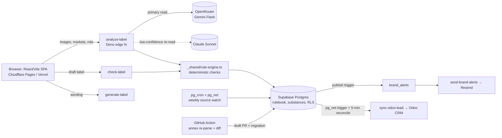

# Technical Architecture and Individual Contribution to the Development of Labelring

**Prepared from:** repository `adminlabelring-png/boih` (278 commits, 2026-03-13 to 2026-10-06), its pull requests, and the live Supabase project's deployment records, as inspected on 11 October 2026. Items marked **[requires confirmation]** are not established by these sources.

## 1. Company and product context

**Problem.** Brands selling cosmetics in Great Britain, Northern Ireland and the EU have to meet the labelling and ingredient rules of Regulation (EC) No 1223/2009 (Article 19 labelling; Annexes II–VI for prohibited, restricted and permitted substances). The GB and EU versions now differ: for example, the EU's expanded fragrance-allergen list (Reg. (EU) 2023/1545, 81 entries) applies from 1 August 2026, while GB keeps its 25. Checking a pack by hand against about 2,300 annex entries per jurisdiction is slow and easy to get wrong.

**Product.** Labelring (`www.labelring.co.uk`) is a web application that (a) reads packaging photos with a vision model and checks them against a versioned, source-cited rulebook, (b) provides a label builder that checks drafts against the same rules and exports print-ready PDFs per market, and (c) monitors the legal sources and flags saved labels affected by a rule change.

**Intended users.** Cosmetics brand owners, Responsible Persons, importers and distributors. The intake asks for role (`manufacturer | importer | distributor`) and market (`GB | NI | EU`). **[Customers, pilots and users: requires confirmation.]**

**Development stage.** It is deployed and live. All five edge functions are `ACTIVE` in production (`analyze-label` is at deployed version 67), and all 37 repository migrations are applied. There is no billing or payment code. Free scans are limited to 3 per day. **Important qualification:** both rulebook versions in production (`2026.1`, `2026.2`) are still *draft*, with 0 of 18 rules and 0 of 4,675 substance rows signed off. The application therefore labels every compliance result "Provisional", by design (`docs/RULEBOOK.md`).

**Alternatives addressed.** The repository itself does not document competitor products **[requires confirmation]**. The limitation it addresses is technical and is shown by the project's own history. In PR #34, a general-purpose vision model scored a hairspray at "70%, Category: Other" and reported fields as *missing* when they were simply not visible in a one-sided photo. That is an unsafe failure mode for a compliance tool.

## 2. My individual role

**What the record shows.** The GitHub account `adminlabelring-png` (my account) owns the repository, opened every PR from #8 to #77 and merged all of them; my former account `sub4568` opened and merged PRs #1–#7. It also holds the production Supabase, Vercel and Cloudflare configuration. Most code was **written by AI coding tools under my direction**:

| Contributor | Evidence | Scope |
|---|---|---|
| Lovable (`gpt-engineer-app[bot]`) | 151 commits, Mar–Jul 2026 | Initial UI scaffold and MVP screens, including the 3 Apr 2026 "Pivot to Label Scanner MVP" |
| Me, via my former personal account `sub4568`, using OpenAI Codex | 13 commits, PRs #1–#7, Mar 2026 | Mock dashboard and UI refinements; the code was Codex-generated (branches `codex/*`), and I prompted and merged it |
| Claude Code (Anthropic) | 43 direct commits, plus the code in the squash-merged PRs #43–#77 (`Co-authored-by: Claude` trailers) | Most of the backend, rule engine, data pipeline and migrations |
| Third-party services | — | Supabase (Postgres, Auth, Storage, Edge Functions), OpenRouter (Gemini Flash and Claude Sonnet models), Resend, Odoo CRM, Vercel / Cloudflare Pages |

**Evidence of my own direction, testing and decisions** (from PR descriptions, which record what I asked for):
- **Defect discovery through real-product testing.** I reported the hairspray false-negative (PR #34), flagged the shape-based coverage heuristics as weak, recommended guided multi-image capture as the long-term fix, and supplied the disclaimer wording. Multi-image scanning followed in PR #36, prompted by my test on a real multi-faced pack. I also reported a scan that hung for more than 5 minutes on a real device (PR #51).
- **Platform decisions.** I moved off Lovable's hosting to our own Supabase project (PR #8) and from Lovable's AI gateway to OpenRouter (PR #9). Later I moved deployment from GitHub Actions to Supabase's GitHub integration plus Vercel and then Cloudflare Pages (PRs #72–#74).
- **Product and architecture direction.** PR #53 is described as "Step 1 of the combined advisor and cofounder plan". It moved compliance decisions out of the AI model and into a versioned rulebook. Steps 1–9 were delivered as PRs #53–#65.
- **Operations.** I configured production secrets and integrations (Odoo, PR #33), ran the rulebook workflow by hand, and found its first failure (PR #66).

**Not evidenced in the repository.** GitHub has no human review comments; many PRs were merged within 1–2 minutes of opening. My design reasoning, reviews and debugging took place in AI-assistant sessions that are not stored in Git (see the separate list of missing evidence).

## 3. System architecture

- **Frontend.** React 18, TypeScript, Vite, shadcn/Radix (`src/`); code-split, prerendered routes (`scripts/prerender.mjs`); print PDF with bleed, crop marks and PDF/X-1a (`src/lib/print-label.ts`, `pdfx.ts`).
- **Backend.** Five Deno edge functions (`supabase/functions/*`). Shared logic lives as pure TypeScript in `supabase/functions/_shared/` with no imports, so **the same rule engine runs in Deno and in the Vitest suite**.
- **Database.** 37 migrations covering versioned rulebook tables, an audit log, quotas, AI-usage telemetry, brand accounts with versioned labels, and alerts.
- **Authentication and authorisation.** Supabase Auth (email, with confirmation). Row-level security is enabled on every table, using `is_admin()` and `is_brand_member()` SECURITY DEFINER helpers. Writes to brands and labels go only through RPCs (`save_brand_label` computes a field diff and refuses saves that change nothing). Rulebook writes are service-role only. EXECUTE is revoked from `anon`/`authenticated` on internal functions.
- **Background jobs.** `pg_cron` runs the Odoo reconciliation every 5 minutes and the Monday source monitor. A GitHub Actions workflow re-parses the annexes every week (`.github/workflows/rulebook-sources.yml`).
- **Deployment.** Supabase's GitHub integration applies migrations and deploys functions on `main`; frontend hosts build `main` with PR previews; `deploy-supabase.yml` is a manual fallback.

**Key architectural decisions (with stated rationale):**
1. **The AI model reads; deterministic rules judge** (PR #53). This keeps the results explainable, ties each one to a legal clause and makes them reproducible across model changes.
2. **Rule data comes from the official texts, not hand entry** (PR #62), with an integrity manifest.
3. **Human sign-off is enforced by the database rather than the UI** (`publish_rulebook_version()` refuses while anything is unverified).

## 4. Technical challenges and solutions

**Challenge 1: Making a probabilistic vision model safe in a compliance setting.**
*Problem:* the model reported unseen fields as "missing" and inferred values it could not read. *Alternatives:* packaging-shape heuristics, which I rejected as weak (PR #34). *Solution:* a four-state field status (`verified / low_confidence / not_verified / missing`). "Missing" is allowed only once full pack coverage is confirmed, and this is enforced at three layers: the prompt, the server (`analyze-label/index.ts`, which downgrades `missing` to `not_verified`) and the client (`buildScanResult` in `src/lib/scan-context.tsx`). A confidence-triggered cascade re-reads with a stronger model only when a *key* field is low-confidence, and merges the two reads field by field by certainty rank (`_shared/scan-fallback.ts`, `fallbackReason`, `mergeReads`). Every call's tokens, latency and reported cost are logged to `ai_usage`, and `ai_cost_daily` gives p95 cost per day. *My contribution:* found and reported the defect through real-product testing, rejected the heuristic approach, specified multi-image capture, and accepted the design. *Verified outcome:* `scan-fallback.test.ts` and `rule-engine.test.ts` pass, and the function is deployed. **Accuracy and cost figures have not been measured in the repository [requires confirmation].**

**Challenge 2: Turning legislation into auditable, machine-checkable data.**
*Problem:* the annexes name substances chemically while labels use INCI names, the official HTML/XML contains merged cells and amendment markers, and GB and EU now diverge. *Solution:* `scripts/rulebook/parse_annexes.py` parses the EU consolidated text (`02009R1223-20260518`) and the GB `legislation.gov.uk` XML, and halts if any entry disappears for a reason other than "deleted in the source". `fetch_cosing.py` links INCI names to annex entries through the Commission's CosIng database (2,113 exact links, per PR #62). `sources.json` records a SHA-256 hash of each source file. `build_migration.py` generates a re-runnable migration in which unchanged entries keep their sign-off. In the database, triggers freeze published versions, reset sign-off when content is edited, and write every change to `rulebook_audit_log`. Whole-term matching stops "Benzophenone" from matching "Benzophenone-3". *Verified outcome:* 4,649 official entries are loaded (GB: 1,734 prohibited, 298 restricted, 25 allergens; EU: 1,737, 291, 81; plus colourants, preservatives and UV filters). `official-annexes.test.ts` (12 tests, e.g. Lilial and Lyral fail by INCI name) and `article19.test.ts` pass. PR #66 reports that re-parsing in a clean environment reproduced the data byte for byte. **No legal reviewer has signed off any entry yet.**

**Challenge 3: Propagating regulatory change to labels already saved.**
*Problem:* rules change after a brand has checked its label. *Solution:* (a) `pg_cron` and `pg_net` hash the provision text on legislation.gov.uk and, because EUR-Lex blocks automated requests, query the EU Publications Office for the latest consolidation identifier (`20260930190000_rulebook_source_monitor.sql`). (b) A weekly Action re-parses the annexes and opens a draft PR listing changes field by field (`diff_data.py` exits with code 3 on a change, so a crash cannot pass as "no change"). (c) On publish, a trigger runs `rulebook_version_changes()` and `queue_brand_alerts()`, which alert only labels whose markets, or named ingredients, are affected; wording-only edits are ignored. Email goes out only after an admin action (`send-brand-alerts`). *Verified outcome:* a simulated change gave the expected diff and exit code (PR #64), and a live dry run found no false changes. **No alert has been sent to a brand [requires confirmation; none can be queued until a version is published].**

## 5. Technical significance

**Standard (not claimed as innovation):** React/Vite/shadcn, Supabase, edge functions, RLS, hosted LLM APIs, and AI-generated code. Model cascades and rules engines are each established techniques.

**Distinctive within this product:**
- An LLM is used strictly as a *transcriber*, inside a deterministic, versioned, clause-cited rulebook whose publication is gated by human sign-off at the database layer.
- The rule data is generated reproducibly from the official GB and EU texts, with integrity hashes, fail-closed parsing and entry-level diffs, so GB/EU divergence (for example 25 vs 81 allergens, and the 2023/1545 sell-through dates) is modelled as data.
- The "no false missing" coverage rule is enforced at three independent layers, which treats a false negative as the most harmful error a compliance tool can make.

Whether these are novel compared with commercial regulatory-technology products is **[requires confirmation through competitor analysis]**.

## 6. Verifiable evidence

- **Code:** `_shared/rule-engine.ts` (`evaluateRules`), `scan-fallback.ts`, `analyze-label/index.ts` (`withFallback`, `applyRulebook`), `scripts/rulebook/*.py`.
- **Migrations:** `20260930120000_cosmetics_rulebook.sql`, `20260930190000_rulebook_source_monitor.sql`, `20261001110000_brand_alerts.sql`, `20261001150000_ai_usage.sql`, `20261001160000_brand_accounts.sql`, `20260727184558_odoo_sync_reconciliation.sql`.
- **Tests:** `npm test` gives 14 files and 101 tests, all passing (run 11 Oct 2026). The build and prerender pass.
- **PRs:** #8, #9, #34, #36, #51, #53, #59, #62, #64, #66, #67, #69 (descriptions record the rationale and my reported test cases).
- **Deployment:** Supabase function versions and migration history; Vercel preview comments on PRs.
- **I must provide manually:** screenshots of a scan (partial-coverage and full-coverage cases), the admin Rulebook and Costs screens, and a print PDF; a short screen-recorded demo; the AI-session transcripts showing my prompts, reviews and debugging; the advisor/co-founder plan; confirmation of my company role and of the co-founder's contribution; and evidence that `sub4568` is my former account (for example, a screenshot of its profile or verified email).

## 7. Conclusion

The strongest substantiated contributions attributable to me are the technical direction and architectural decisions behind Labelring, together with its integration and production operation. These are: separating AI perception from deterministic, source-cited compliance judgement; building the rulebook from the official legislation with database-enforced human sign-off; and an automated pipeline that takes regulatory change through to affected brand labels. These turn unreliable model output into explainable, auditable results, which is the core of the product's value. Most of the source code was generated by AI coding tools under my direction. My contribution is shown by the decisions, defect reports, testing and integration recorded in the pull requests, rather than by personally writing the code. The rulebook has not yet been legally signed off, and no customer or usage outcomes are established by this evidence. This document does not assess eligibility.
